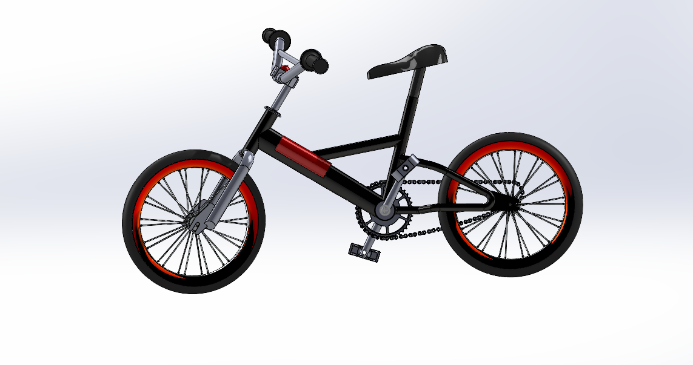

# 3D Bicycle Modeling Project

A collaborative 3D CAD modeling project completed as part of EG1005 — 3D Modelling and 3D Printing Technology at Assumption University.

## Project Overview

This project involved creating 3D models of bicycle components using SolidWorks, following instructional references from YouTube. The modeling tasks were divided between two team members.

## Software Used
- SolidWorks

## My Contributions

I was responsible for modeling the following components:
- Steering
- Pedal
- Link
- Tyre
- Pin

## Team Collaboration

My teammate modeled the following components:
- Frame
- Bottle Holder
- Seat
- Chain
- Bell

We collaborated to complete the bicycle component modeling project, with each team member responsible for a designated set of components.

## Skills Demonstrated
- 3D CAD Modeling
- Mechanical Component Modeling
- SolidWorks
- Teamwork and Collaboration

## Project Outcome

Completed the assigned bicycle component models as digital CAD models for university coursework. No physical prototype was produced.

## Reference

The modeling process was guided by instructional materials from the following YouTube playlist:

[YouTube Tutorial Playlist](https://youtube.com/playlist?list=PLVefyvgCJmlbEXU-cxkl0LEUC-ZHEghb-)

**Course:** EG1005 — 3D Modelling and 3D Printing Technology  
**Institution:** Assumption University  
**Project Type:** Collaborative Coursework
